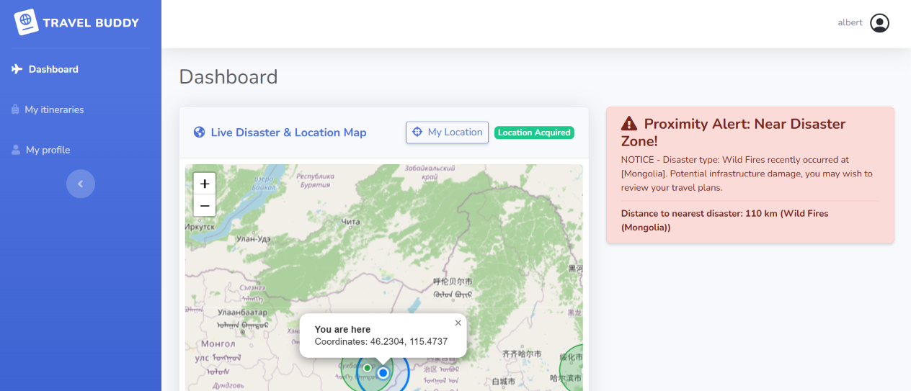
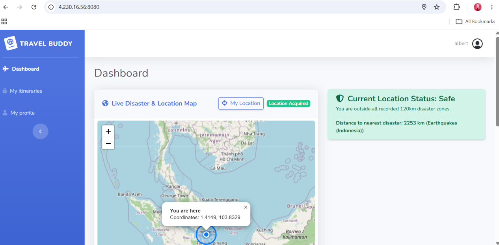
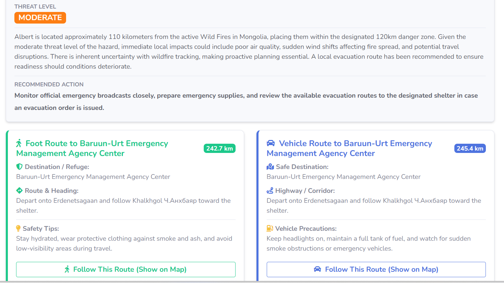
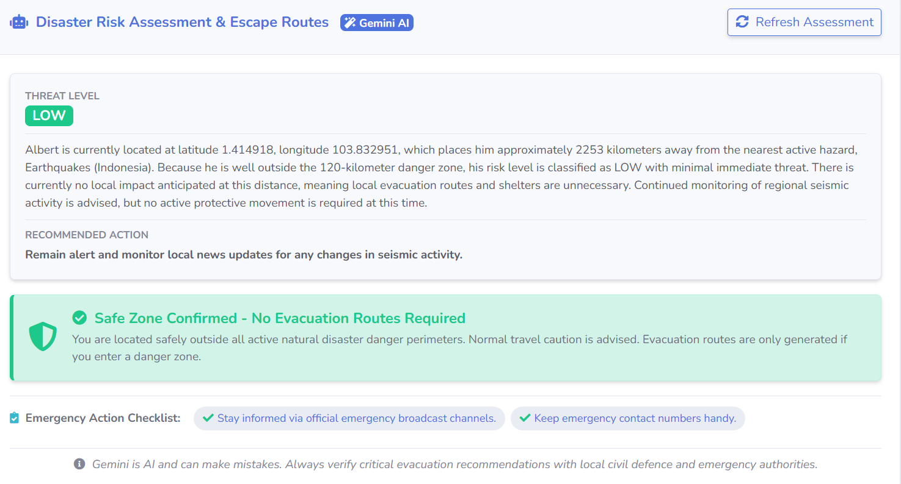
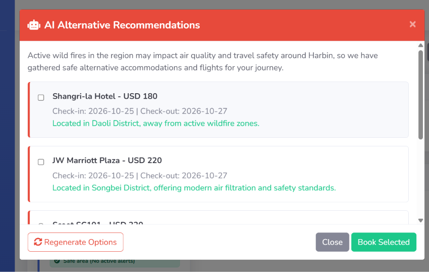

# CS203-G4-Team5

**Things to note:**
As the AI tokens are limited on free tier only, sometimes you might encounter fallback error messages or incomplete result. To resolve, try to regenerate the result, if still cannot can reach out to me for a new API key to generate for the AI.

**Steps to try out for AI features and disaster monitoring:** 
**1) To stimulate the red disaster alert:**
First, enable the insecure origin so that location can be detected then will prompt to relaunch browser. Ensure in system setting location is on.

Secondly, open inspect tools and press 'esc' key to open the sensor tab then input the following coordinates for trying out red disaster monitoring alert

To try out danger disaster monitoring, use Mongolia coordinates
(Latitude: 46.2304, Longtitude: 115.4737)
To try out safe disaster monitoring, use Tokyo coordinates (Latitude: 35.689487, Longtitude: 139.691706)

Lastly, reload the page and it will show the updated red disaster alert

Then click Generate AI Risk Assessment to get risk assessment report on stimulated live location.

Once try out is finished, remember to disable back the insecure origin

**2) To get AI to replan alternative itinerary:** (Can refer to feature 3 below for image reference) 
First, select itinerary that has red disaster monitoring on it.
Secondly, click replan with AI button at top right.
Thridly, select flight and/or hotel you want AI to help replan.
Lastly, once AI returns result and you selected the alternative to book, it will bring you to stimulated payment page. Once done, will redirect to detailed itinerary page and see that flight and/or hotel is updated

**Features:** 
**1) Real-time disaster monitoring with disaster zones shown on map**
If proximity within 120km to disaster zone, red alert shown indiciating risk to user current live location. Disaster data got from GDACS API

If not close to any disaster zone, green alert shown indicating no risk to user current live location.

**2) AI risk assessment to evaluate current live location risk against disaster situation.** 
Provide advice to users and recommendation on how user can prepare themself for the disaster situation. Route recommendation provided if user detected in danger zone.

When disaster monitoring detect user live location in safe zone

**3) AI itinerary replanning feature (Take note it only currently applies for flight and hotel only)** 
Explore flights and hotels taken from live API (Sabre API). When hotels or flights are affected by disaster situation, disaster monitoring indicates red alert on respective itinerary item. User can choose to replan with AI and select what alternatives (flight and/or hotels) to find. With human in the loop, to ensure AI ask for user confirmation before proceeding to stimulated booking process.

AI recommended alternative found from Sabre API

**4) Profile management** 
Add emergency contact details and update your profile details or change password

**5) Itinerary management** 
Create itinerary to plan for future trip and add intended hotels,flights or attractions to go.
